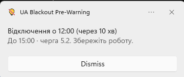
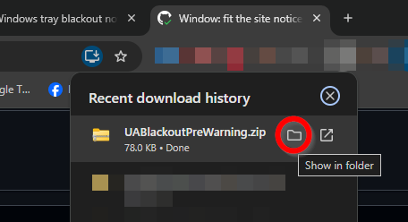
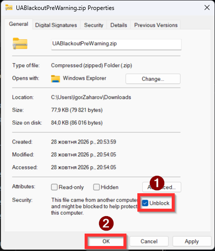
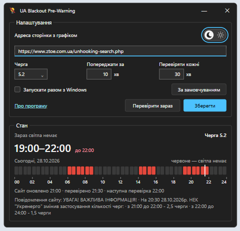
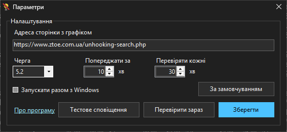
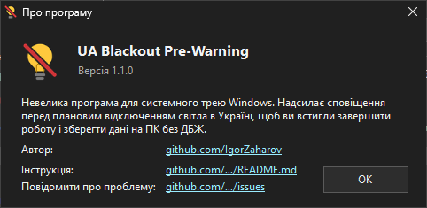

<p align="center">
  
</p>

# UA Blackout Pre-Warning

### [Завантажити останню версію (UABlackoutPreWarning.zip)](https://github.com/IgorZaharov/UABlackoutPreWarning/releases/latest/download/UABlackoutPreWarning.zip)

Як завантажити і запустити - у розділі [Завантаження і запуск](#завантаження-і-запуск).
Про проблеми можна повідомити [тут](https://github.com/IgorZaharov/UABlackoutPreWarning/issues).

Невелика програма для Windows, яка живе в системному треї, стежить за графіком погодинних відключень
[Житомиробленерго](https://www.ztoe.com.ua/unhooking-search.php) і заздалегідь попереджає про відключення
світла - щоб ви встигли зберегти роботу на комп'ютері без ДБЖ.

- Один файл `UABlackoutPreWarning.exe`, встановлення не потрібне.
- Працює на Windows 10 і Windows 11 (32- і 64-розрядних) без додаткових програм.
- Мова інтерфейсу - як у Windows: українська або англійська.

## Як це працює

1. Програма завантажує сторінку з графіком і знаходить таблицю внизу сторінки.
2. Червоні клітинки у рядку вашої черги - це періоди без світла. Кілька червоних клітинок поспіль
   програма вважає одним відключенням (наприклад, 14:00–16:00).
3. За вказану кількість хвилин до початку відключення з'являються спливаюча підказка біля значка в треї
   і сповіщення Windows зі звичайним звуком. Сповіщення лишається на екрані, доки ви його не закриєте,
   і зберігається в центрі сповіщень
   Windows (клацніть по годиннику або натисніть **Win + N**), тож його важко пропустити.
   Про кожне відключення програма попереджає **лише один раз**.

   

4. Графік перевіряється знову через заданий інтервал. Якщо обленерго змінить час початку відключення,
   ви отримаєте нове попередження.

## Завантаження і запуск

1. Завантажте архів за посиланням [UABlackoutPreWarning.zip](https://github.com/IgorZaharov/UABlackoutPreWarning/releases/latest/download/UABlackoutPreWarning.zip).
2. У списку завантажень браузера натисніть значок папки **«Показати в папці»** - відкриється папка
   із завантаженим файлом.

   

3. Розблокуйте архів: клацніть по `UABlackoutPreWarning.zip` правою кнопкою миші → **«Властивості»**,
   поставте позначку **«Розблокувати»** (**Unblock**) і натисніть **«OK»**.
   Тоді Windows не показуватиме попередження під час запуску програми.

   

4. Розпакуйте архів (правою кнопкою → **«Видобути все…»**) і покладіть файл `UABlackoutPreWarning.exe`
   у зручну постійну папку, наприклад `Документи\Програми`.
5. Запустіть `UABlackoutPreWarning.exe` подвійним клацанням.
   - Якщо Windows усе ж покаже вікно **«Windows захистила ваш ПК»**, натисніть **«Докладніше»** →
     **«Виконати в будь-якому разі»**. Це звичайне попередження для програм без цифрового підпису.
6. Під час першого запуску відкриються головне вікно і вікно налаштувань. Перевірте чергу, натисніть
   **«Зберегти»** і закрийте обидва вікна - програма продовжить працювати в треї.

Значок програми - жовта лампочка, перекреслена червоною лінією - з'явиться біля годинника.
Якщо його не видно, натисніть стрілку **^** біля годинника: значок може бути серед прихованих.
Щоб він завжди був на видноті, перетягніть його на панель завдань.


## Питання і Відповіді

Q: Навіщо? Є ж бот! Є ж Світлочек!
А: В моїй черзі (наприклад) РЕС присилає повідомлення запізно. Світлочек постійно просить перенабрати адресу.

Q: Які міста?
A: Наразі тільки Житомир, інші РЕСи всі роблять по-різному. Поки не планую інші міста.

Q: Для кого це?
А: Хто багато сидить за компом і хоче повідомлення щоб встигнути щось вимкнути/зробити ітд. Наприклад комп без ДБЖ.

Q: А для мобільного? 
А: В процесі розробки, публікації, ітд. Трошки пізніше буде.


## Вікно програми

Головне вікно відкривається подвійним клацанням по значку в треї або через пункт меню **«Відкрити»**.
У ньому показано стан графіка, а праворуч угорі є три кнопки:

| Кнопка | Що робить |
| --- | --- |
| **⚙ (шестерня)** | Відкриває вікно [налаштувань](#налаштування). |
| **?** | Відкриває вікно [«Про програму»](#про-програму). |
| **Перемикач день/ніч** (сонце / місяць) | Вмикає світлу або темну [тему](#світла-і-темна-тема). |



### Стан

- **Черга** - вибрана черга. Якщо такої черги немає на сторінці, напис стане червоним.
- **Наступне відключення** - час найближчого відключення і скільки до нього лишилося.
  Якщо світла вже немає, буде написано **«Зараз світла немає»** і до котрої години.
- **Смужка на сьогодні** - 24 блоки годин, кожен із двох половинок по 30 хвилин: червоні - світла немає,
  риска - поточний час. Підписи під смужкою - кожні 2 години (00, 02, 04 … 24).
- Нижче - коли сайт оновив графік, коли програма перевіряла його востаннє і коли перевірить знову,
  а також оголошення з верхньої частини сайту.

Кнопка закриття вікна (✕) лише ховає вікно в трей - програма продовжує працювати.

### Налаштування

Вікно **«Параметри»** відкривається кнопкою з шестернею **⚙** у головному вікні.



| Поле | Що робить | За замовчуванням |
| --- | --- | --- |
| **Адреса сторінки з графіком** | Сторінка, з якої програма бере графік. Зазвичай змінювати не потрібно. | `https://www.ztoe.com.ua/unhooking-search.php` |
| **Черга** | Ваша черга і підчерга (рядок таблиці). Список заповнюється рядками з сайту: 1.1, 1.2 … 6.2. | `5.2` |
| **Попереджати за** | За скільки хвилин до відключення показати сповіщення (від 1 до 120). | 10 хв |
| **Перевіряти кожні** | Як часто завантажувати графік з сайту (від 5 до 240 хвилин). | 30 хв |
| **Запускати разом з Windows** | Програма запускатиметься автоматично після входу в Windows. | вимкнено |

Кнопки:

- **«Зберегти»** - запам'ятовує налаштування і одразу їх застосовує.
- **«Перевірити зараз»** - негайно завантажує свіжий графік із сайту.
- **«Тестове сповіщення»** - показує сповіщення про найближче відключення у вашій черзі (з позначкою «Тест»),
  щоб перевірити, що сповіщення працюють. Справжні попередження це не змінює: про це відключення програма
  все одно попередить вчасно.
- **«За замовчуванням»** - повертає стандартні значення всіх полів (якщо щось налаштували не так).
  Щоб застосувати їх, натисніть **«Зберегти»**.

Посилання **«Про програму»** у лівому нижньому куті відкриває вікно «Про програму».
Щоб закрити вікно налаштувань без збереження змін, натисніть ✕ або **Esc**.

### Світла і темна тема

Перемикач **день/ніч** у правому верхньому куті головного вікна вмикає світлу або темну тему:

- кружечок **праворуч із сонцем** - світла тема;
- кружечок **ліворуч із місяцем** - темна тема (як на знімку вище).

Тема змінюється одразу після клацання (або клавішею **Пробіл**, коли перемикач виділено) для всіх вікон
програми і меню в треї. Вибір запам'ятовується сам - натискати «Зберегти» не потрібно.

### Про програму

Вікно відкривається кнопкою **?** у головному вікні, посиланням у вікні налаштувань або через меню в треї.
У ньому - опис і версія програми, а також посилання:



- **Автор** - сторінка автора на GitHub;
- **Інструкція** - ця інструкція;
- **Повідомити про проблему** - сторінка [Issues](https://github.com/IgorZaharov/UABlackoutPreWarning/issues),
  де можна описати помилку або побажання.

## Як дізнатися свою чергу

1. Відкрийте [сторінку пошуку черги](https://www.ztoe.com.ua/unhooking-search.php).
2. Оберіть свій РЕМ, населений пункт і вулицю.
3. У таблиці знайдіть свій будинок і подивіться стовпці **«Черга»** і **«Підчерга»**.
   Наприклад, черга **5** і підчерга **2** - це **5.2**.
4. Виберіть це значення у полі **«Черга»** у вікні налаштувань (кнопка **⚙**) і натисніть **«Зберегти»**.

## Автозапуск разом з Windows

1. Відкрийте вікно програми і натисніть кнопку з шестернею **⚙**.
2. Поставте позначку **«Запускати разом з Windows»**.
3. Натисніть **«Зберегти»**.

Тепер програма запускатиметься сама після кожного входу в Windows. Права адміністратора для цього не потрібні.
Щоб вимкнути автозапуск, зніміть позначку і натисніть **«Зберегти»**.

Якщо ви перемістили файл програми в іншу папку, запустіть його один раз з нового місця -
програма сама оновить шлях для автозапуску.

## Меню в треї

Клацніть правою кнопкою миші по значку:

- **«Відкрити»** - показати вікно програми.
- **«Перевірити зараз»** - завантажити графік негайно.
- **«Про програму»** - опис програми, версія, посилання на автора, інструкцію і сторінку для повідомлень про проблеми.
- **«Закрити програму»** - повністю завершити роботу програми.

Якщо навести вказівник на значок, з'явиться підказка з часом наступного відключення.

## Якщо сповіщення не з'являються

- Перевірте, що у полі **«Черга»** вибрано саме вашу чергу.
- Натисніть **«Тестове сповіщення»** у вікні налаштувань: якщо тестове сповіщення з'явилося, сповіщення працюють.
- Про кожне відключення програма попереджає лише один раз. Якщо ви вже отримали попередження, а потім змінили
  **«Попереджати за»**, повторного попередження про це відключення не буде.
- Переконайтеся, що сповіщення Windows увімкнені: **Параметри → Система → Сповіщення**, і що в списку
  програм там увімкнено **UA Blackout Pre-Warning**.
- Режим **«Не турбувати»** у Windows 11 (у Windows 10 - режим фокусування уваги) може приховувати сповіщення.
- Якщо сайт недоступний, програма повторить спробу через 1, 2 і 5 хвилин, а після кількох невдач покаже
  сповіщення, що графік може бути застарілим. Попередження й далі показуються за останнім завантаженим графіком.

## Повідомити про проблему

Про помилки й проблеми, а також з побажаннями пишіть сюди:
[github.com/IgorZaharov/UABlackoutPreWarning/issues](https://github.com/IgorZaharov/UABlackoutPreWarning/issues).

Щоб швидше розібратися, вкажіть версію програми (вікно **«Про програму»**), версію Windows і, якщо можна,
додайте знімок екрана вікна програми.

## Де зберігаються налаштування

Усі налаштування зберігаються в реєстрі Windows поточного користувача:
`HKEY_CURRENT_USER\Software\UABlackoutPreWarning`. Біля файлу програми нічого не створюється.

Для сповіщень програма також реєструє свою назву в
`HKEY_CURRENT_USER\Software\Classes\AppUserModelId\IgorZaharov.UABlackoutPreWarning` і зберігає значок
сповіщень у папці `%LOCALAPPDATA%\UABlackoutPreWarning` (файл `toast-icon.png`).

## Як видалити програму

1. Зніміть позначку **«Запускати разом з Windows»** і натисніть **«Зберегти»**.
2. Клацніть правою кнопкою по значку в треї → **«Закрити програму»**.
3. Видаліть файл `UABlackoutPreWarning.exe`.
4. За бажанням видаліть налаштування і значок сповіщень командами:
   ```
   reg delete HKCU\Software\UABlackoutPreWarning /f
   reg delete HKCU\Software\Classes\AppUserModelId\IgorZaharov.UABlackoutPreWarning /f
   rmdir /s /q "%LOCALAPPDATA%\UABlackoutPreWarning"
   ```

## Для розробників

- Мова - C# 5, .NET Framework 4.6.2, без сторонніх бібліотек.
- `build.cmd` збирає програму компілятором, який уже є в кожній Windows 10/11
  (`%WINDIR%\Microsoft.NET\Framework64\v4.0.30319\csc.exe`), і запускає тести.
  Результат - `out\UABlackoutPreWarning.exe`.
- `build.sh` - збирання для розробки в Linux/macOS через Mono.
- `tests/` - тести розбору сторінки і логіки попереджень; `tests/Fixtures/` - збережена сторінка сайту.
- `tools/make_icon.py` - генерує значок `assets/app.ico`.
- `tools/screenshots/` і workflow **screenshots** (запуск вручну в GitHub Actions) - знімки вікон для цієї
  інструкції на справжній Windows потрібною мовою інтерфейсу (за замовчуванням `uk-UA`);
  результат з'являється в гілці `screenshots`.
- Архітектура і план - у [docs/DESIGN.md](docs/DESIGN.md).
- Кожне надсилання в `main` збирається в GitHub Actions; тег `v*` створює реліз з exe-файлом.

## Ліцензія

[GNU General Public License v3.0](LICENSE).
